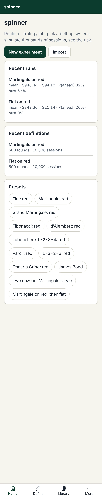
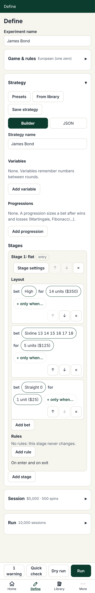
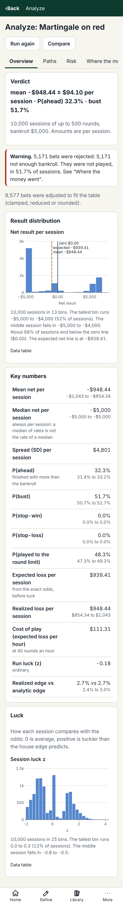
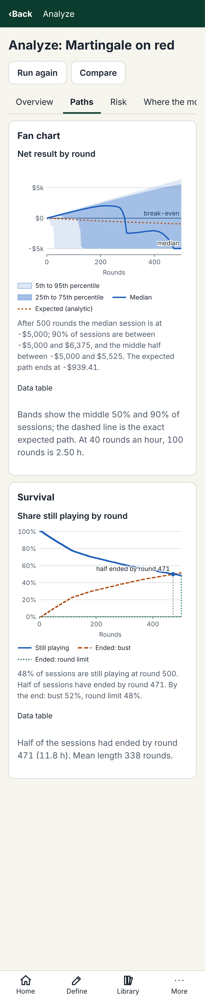
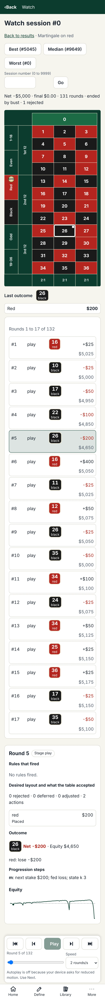

# spinner

A roulette **strategy lab**: define a betting strategy (which may change from one spin to the next), run it over thousands of seeded simulated sessions in your browser, and analyze the distribution of outcomes: average result, volatility, bust risk, drawdowns, and how the strategy actually behaved.

Static web app for GitHub Pages; no backend, no accounts. Everything stays on your device.

## Use it

- **Open it:** <https://creynia.com/spinner/>
- **Add to Home screen (Android/Chrome):** open the link, tap the Chrome menu (three dots), then **Add to Home screen** (or **Install app**). On iPhone/iPad (Safari): tap **Share**, then **Add to Home Screen**. It launches full screen and works offline after the first load.

| Home                                                                              | Define                                                              | Analyze                                                                                                   |
| --------------------------------------------------------------------------------- | ------------------------------------------------------------------- | --------------------------------------------------------------------------------------------------------- |
|  |  |  |

### How to

1. **Define.** Tap **New experiment**, pick a strategy from **Presets** (flat, Martingale, Fibonacci, James Bond, Labouchere and more) or build your own from stages, bets and rules, then set the bankroll, unit, spins per session and the number of sessions (10,000 sessions of 500 spins is the default). **Quick check** runs 200 sessions in under a second and shows a one-line verdict; **Dry run** replays one session so you can see what the strategy does.
2. **Run.** **Run** simulates every session in background workers on your device, with a live fan chart and histogram. Closing the tab or reloading mid-run is safe: reopen the run and tap **Resume**; the finished results are identical to an uninterrupted run with the same seed.
3. **Analyze.** Overview (verdict, distribution, key numbers with confidence intervals), Paths, Risk (drawdown, exposure, bust), Where the money went, Convergence, and Sessions. Tap any session to **Watch** it round by round with the rules that fired. **Compare** two or more runs side by side (paired by session when they share a seed).
4. **Share and export.** On **Analyze, Export**: a run file (`.spinner.json.gz`) that **Import** reads back exactly, `summaries.csv` for spreadsheets, `definition.json`, and a **share link** that carries the whole definition (nothing is uploaded). Imported runs are marked "imported" and analyze exactly like local ones. Results live in your browser's storage only, so export anything you want to keep.

| Paths                                                                                   | Watch                                                                                    | Compare                                                          |
| --------------------------------------------------------------------------------------- | ---------------------------------------------------------------------------------------- | ---------------------------------------------------------------- |
|  |  |  |

On a desktop the same screens go side by side ([Analyze](docs/screenshots/analyze-overview-1280-light.webp), [Watch](docs/screenshots/watch-1280-light.webp), [Gallery](docs/screenshots/gallery-1280-light.webp)); dark mode follows your system ([Analyze, dark](docs/screenshots/analyze-overview-390-dark.webp)). More screenshots are in [`docs/screenshots/`](docs/screenshots/).

- **Gallery:** curated result bundles (flat, Martingale, Fibonacci, d'Alembert, Labouchere, James Bond; 10,000 sessions of 500 spins each) open read-only from **More**, then **Gallery**. A bundle you open is kept for offline use.
- **Updates:** the installed app updates itself and shows "Update available · Reload" (or "Reload (run will resume)" while a run is active). If it doesn't, open **Settings**, then **Check for updates**, and tap **Reload** on the toast. If none shows, close the app completely and open it again.

## Is this gambling advice?

No. Every roulette bet has a house edge; no betting system changes it. This is a simulation for understanding risk, not advice. If gambling is a problem for you, seek help (e.g. a national gambling helpline).

## Privacy

Sync is optional. Everything stays in your browser unless you sign in with Google.

> **Google Drive sync (optional).** If you sign in with Google, spinner keeps a copy of your library and runs in a hidden app folder in your own Google Drive. spinner can see only that folder (the `drive.appdata` scope), never your other files, and there is no spinner server: your data goes only between this browser and Google. To remove it, use Settings → Account → Remove my data from Drive, or Google Drive → Settings → Manage apps → spinner → Delete hidden app data. You can revoke access at myaccount.google.com/permissions.

The data is not end-to-end encrypted: it is readable by you and by Google. Signing out keeps your local data. The design is in [`docs/design/sync.md`](docs/design/sync.md) (§10).

## Develop

Requires Node >= 22.12 (see `.nvmrc`).

```sh
npm ci
npm run dev        # local dev server
npm run check      # lint, typecheck, format check, gallery size check, unit tests
npm run build      # dist/ (the PWA, service worker and gallery index)
npm run test:e2e   # Playwright (builds first; see CONTRIBUTING.md)
```

The plan is in [PLAYBOOK.md](PLAYBOOK.md) and the design documents are in [`docs/design/`](docs/design/) (start with `decisions.md`, which wins over everything else). The game-agnostic core is [`src/core`](src/core/README.md). See [CONTRIBUTING.md](CONTRIBUTING.md) to get involved.

### Static pages for search engines

`npm run build` also writes plain HTML pages with the gallery runs' real numbers at
[`/spinner/strategies/`](https://creynia.com/spinner/strategies/), plus `sitemap.xml`, `llms.txt` and
`llms-full.txt`. They are generated from the committed gallery bundles by the app's own analysis code;
see [`docs/seo.md`](docs/seo.md).

### Deploying

`main` deploys to GitHub Pages through `.github/workflows/pages.yml` (Pages source: GitHub Actions). If a deploy fails with "deployment in progress", re-run the failed job. After a deploy the workflow pings IndexNow with the sitemap URLs (best effort).

## License

[MIT](LICENSE)
